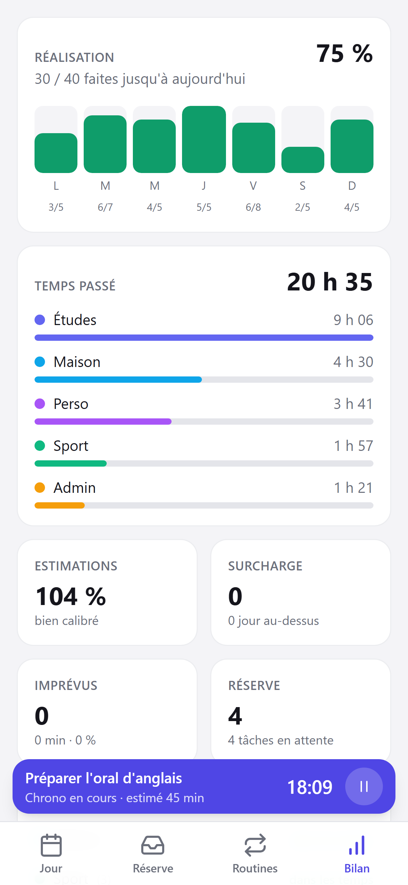
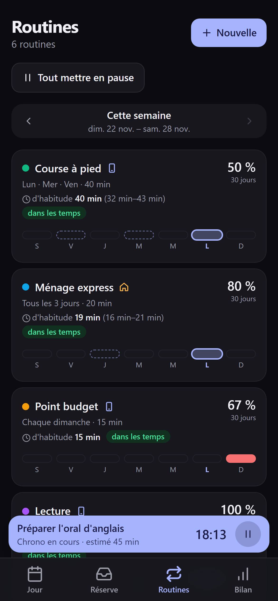
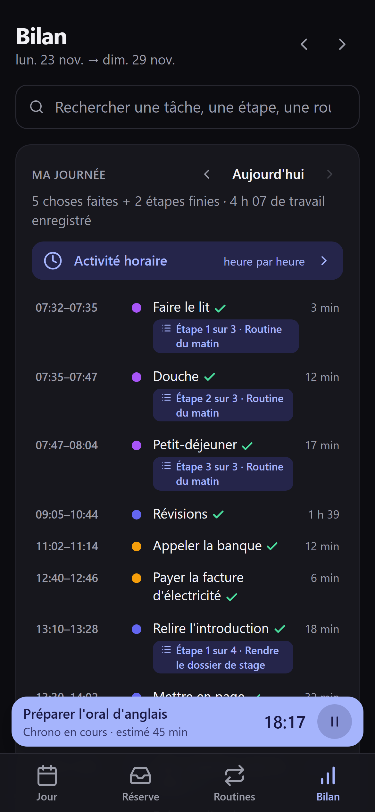

<div align="center">


# Ma journée

**A daily planner, habit tracker and time tracker in one installable app.**

Plan your day, check that it actually fits, time what you do and see where your hours really go, all stored on your device, with no account and no server.

[**Live demo**](https://nathan-part.github.io/todo-list/) · [Features](#features) · [Tech stack](#tech-stack) · [Getting started](#getting-started)


[](LICENSE)

</div>

<p align="center">
  
  
  
  
</p>

Every morning, the app answers three questions:

1. **What do I have to do today, and does it fit in my day?**
2. **Where does my time really go?**
3. **What did I actually get done?**

## Features

- **Day view**: a week strip shows each day's planned workload against the time available, and overloaded days turn red.
- **Quick add**: name, estimated duration, day or backlog, category, optional fixed time, deadline and note.
- **Nothing gets lost**: an unfinished task moves to the backlog at the end of the day, and a one-card-at-a-time review helps you reschedule it.
- **Subtasks**: split a task into steps, each with its own estimate and timer.
- **Routines**: every day, on chosen weekdays or every N days, with steps, pauses for holidays, an end date and completion rates over 7 and 30 days.
- **Time tracking**: one timer at a time, a full-screen focus mode, a mini player on every tab and a "forgotten timer?" prompt after 3 hours.
- **Daily summary**: what you did, at what time and for how long, with gaps in the day flagged so you can fill them in.
- **Weekly review**: completion rate, time per category, estimate accuracy, and suggestions when a routine's estimate keeps drifting.
- **"I'm going to bed"**: the day switches when you tap it, or automatically at 5 a.m.
- **Gestures**: long-press and drag to reorder, swipe to postpone or delete, with undo.
- **Automatic daily backup** on the device, plus export and import to a JSON file.
- **Version history** inside the app, so you can see what each update brought.
- **Works offline** and installs to the home screen like a native app.

> The interface is in French.

## Privacy by design

Ma journée is **local-first**. All data lives in the browser's IndexedDB on your device. Nothing is ever sent to a server, there is no account, no tracking and no analytics.

Because nothing is synced, export a backup from time to time in the settings.

## Tech stack

| Area | Choice |
| --- | --- |
| UI | React 19, TypeScript (strict), Tailwind CSS 4 |
| Build | Vite 8 |
| Storage | IndexedDB via Dexie 4, with live queries (`dexie-react-hooks`) |
| PWA | `vite-plugin-pwa` (Workbox service worker, web manifest, update prompt) |
| Drag and drop | dnd-kit |
| Dates | date-fns |
| Tests | Vitest + fake-indexeddb, 160 tests on the business rules |
| CI/CD | GitHub Actions → GitHub Pages, optional SFTP deployment |

### Implementation notes

- **Three separate concepts**: the *item* (what to do: a task or a routine), the *entry* (its presence on a given day and what happened: done, not done, postponed, skipped) and the *session* (time actually spent). A naive to-do app mixes them up.
- **Idempotent day rollover**: entries have deterministic IDs (`routine + scheduled date + day`), so the end-of-day processing can run any number of times without creating duplicates, even after several days without opening the app, across clock changes, or with a timer running at midnight.
- **Reliable history**: postponing a task leaves a trace on the original day, and nothing is ever overwritten.
- **Missed routines don't pile up**: a missed occurrence is recorded as "not done", and optional routines don't lower the completion rate.
- **Framework-free domain**: all business logic lives in `src/domain/`, independent of React and fully tested, including a randomized usage test.

The full functional specification (in French) is in [`docs/cahier-des-charges.md`](docs/cahier-des-charges.md).

## Getting started

Requires Node.js 22 or newer and Git.

```bash
git clone https://github.com/Nathan-Part/todo-list.git
cd todo-list
npm install
npm run dev
```

Then open http://localhost:5173. The dev server is also exposed on your local network, so you can open it on your phone using your computer's IP address. Note that the offline mode (service worker) only works with a production build: `npm run build && npm run preview`.

| Script | Description |
| --- | --- |
| `npm run dev` | Start the development server |
| `npm test` | Run the unit tests |
| `npm run typecheck` | Check the TypeScript types |
| `npm run build` | Type-check and build for production into `dist/` |
| `npm run preview` | Serve the production build locally |

## Deployment

The app is a fully static site, so it can be hosted for free anywhere.

**GitHub Pages (preconfigured)**: in the repository settings, go to **Pages** and set **Source** to **GitHub Actions**. Every push to `main` then runs `.github/workflows/pages.yml`, which tests, builds and publishes the site.

**Your own domain**: build with the default base path (`npm run build`) and upload `dist/`.

**SFTP (optional)**: `.github/workflows/deploy.yml` uploads the build over SFTP on every push to `main`. It stays disabled until you set the repository variable `DEPLOY_ENABLED=true` and the secrets `SFTP_HOST`, `SFTP_USER`, `SFTP_PASSWORD` and `SFTP_DIR`.

## Install on your phone

Open the live site, then:

- **iPhone (Safari)**: Share → **Add to Home Screen**
- **Android (Chrome)**: menu ⋮ → **Install app**

## Project structure

```
src/
├── domain/              # Business logic, framework-free and fully tested
│   ├── actions.ts       # Every write: add, complete, postpone, timers, routines
│   ├── rollover.ts      # End-of-day processing (idempotent)
│   ├── queries.ts       # Read models used by the UI (live queries)
│   ├── routines.ts      # Recurrence rules
│   └── *.test.ts        # Unit tests
├── views/               # Screens and bottom sheets
├── components/          # Reusable UI: rows, timer, pickers, swipe
└── lib/                 # Hooks, formatting, navigation, toasts
```

## Roadmap

- Encrypted automatic backup
- Notifications
- Multi-device sync

## License

[MIT](LICENSE) © Nathan-Part
